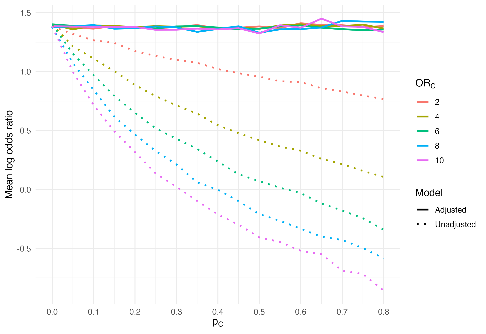

# Bias correction with meta-regression

If a systematic review identifies multiple studies from different populations that
all failed to adjust for a strong (negative) confounder, can we estimate an unbiased 
summary effect size?

This simulation examines how failure to adjust for a binary confounder changes
the estimated association between exposure and disease. Each point summarizes
the mean log odds ratio across 100 simulated populations. Colors represent the
confounder's conditional odds ratio ($OR_C$), while the horizontal axis shows
its population prevalence ($p_C$).

The solid lines are estimates from the adjusted model, `D ~ E + C`, and remain
near the true exposure effect, $\log(OR_E) = \log(4)$. The dotted lines are
estimates from the unadjusted model, `D ~ E`. Their increasing downward bias
shows how stronger or more prevalent confounding can mask—and eventually
reverse—the estimated exposure association when the confounder occurs only
among unexposed individuals.

Notice that the effect size for a prevalence of 0 is the adjusted effect size. Would the
intercept term from a meta-regression give us a good estimate?

[The code was written with the help of CodeX.]
